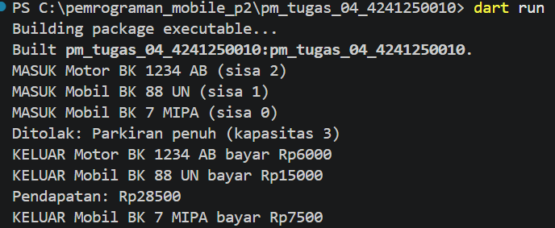

SISTEM PARKIR KAMPUS (CONSOLE)

1. Identitas

- Nama: Dwi Nina Putri Anakampun
- NIM: 4241250010
- Mata Kuliah: Pemrograman Mobile
- Praktikum: Pertemuan 4
- Program Studi: Ilmu Komputer

2. Diagram Kelas

mermaid
classDiagram
    class Kendaraan {
        <<abstract>>
        +String plat
        +DateTime waktuMasuk
        +jenis
        +tarifPerJam
        +biaya(DateTime keluar)
    }

    Kendaraan <|-- Motor
    Kendaraan <|-- Mobil
    Kendaraan <|-- Truk
    Mobil <|-- MobilMember
    Kendaraan <|-- Berlangganan

    class Berlangganan {
        <<mixin>>
        +biaya(DateTime keluar)
    }

    class Parkiran {
        -List~Kendaraan~ _kendaraan
        -int _pendapatan
        +int kapasitas
        +int sisa
        +int pendapatan
        +masuk()
        +keluar()
    }

    class ParkirPenuh {
        <<exception>>
        +String pesan
    }

    Parkiran --> Kendaraan
    Parkiran ..> ParkirPenuh
    MobilMember ..> Berlangganan

3. Screenshot Keluaran

 4. Penerapan Konsep OOP dan Asynchronous Programming

Sistem Parkir Kampus menerapkan enkapsulasi melalui atribut privat `_kendaraan` dan `_pendapatan` pada kelas Parkiran. Akses terhadap data tersebut dilakukan melalui getter dan method yang tersedia. Polimorfisme diterapkan melalui abstract class Kendaraan yang memiliki beberapa subclass, yaitu Motor, Mobil, dan Truk. Setiap subclass memiliki jenis dan tarif parkir yang berbeda, tetapi dapat diproses menggunakan tipe Kendaraan yang sama. Mixin Berlangganan digunakan pada MobilMember untuk memberikan potongan biaya parkir sebesar 50%.

Asynchronous programming diterapkan melalui method masuk() dan keluar() yang menggunakan Future, async, dan await. Future.delayed digunakan untuk mensimulasikan proses palang parkir otomatis. StreamController.broadcast() digunakan untuk mengirimkan informasi kendaraan masuk dan keluar kepada listener sehingga setiap kejadian dapat ditampilkan pada terminal.

5. Pernyataan Penggunaan AI

Dalam pengerjaan tugas ini, saya menggunakan AI sebagai bantuan untuk memahami materi dan mencari solusi ketika mengalami kesulitan dalam penulisan kode. Kode program tetap saya jalankan dan uji sendiri menggunakan Dart di VS Code.

6. Pemeriksaan Program

- Analisis kode: `dart analyze`
- Pengujian program: `dart test`
- Hasil analisis: No issues found!
- Hasil pengujian: All tests passed!